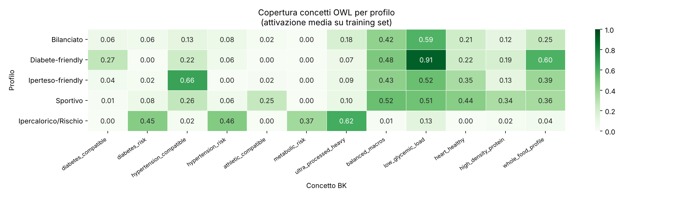
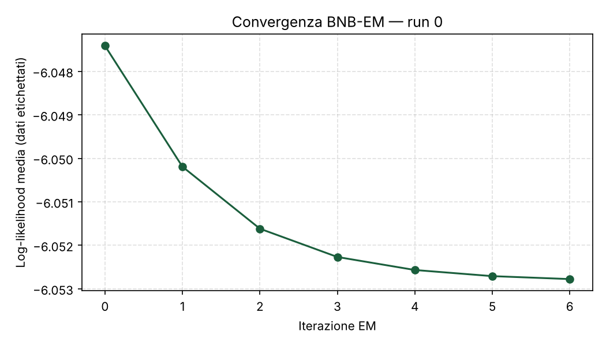
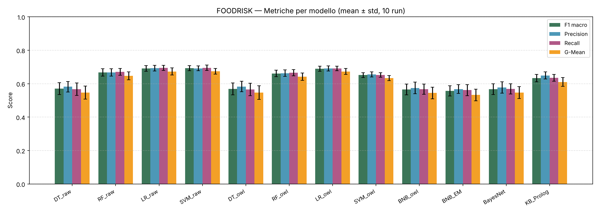
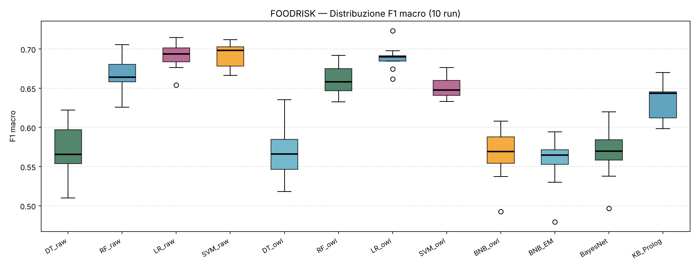
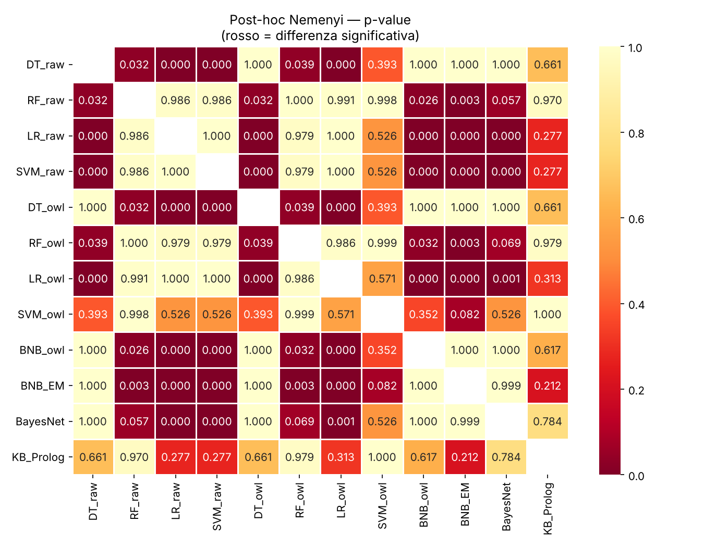

# FOODRISK — Documentazione del caso di studio

*Meal Nutritional Risk Knowledge-Based Classification System*

**Progetto di Ingegneria della Conoscenza** — A.A. 2025/2026
Università degli Studi di Bari Aldo Moro
Autore: Giorgio Crescenza — matricola 698991 — g.crescenza2@studenti.uniba.it

## Indice

1. [Introduzione](#1-introduzione)
2. [Dataset](#2-dataset)
3. [Obiettivi](#3-obiettivi)
4. [Argomenti del corso e mappa del codice](#4-argomenti-del-corso-e-mappa-del-codice)
5. [Background Knowledge ontologica (OWL) e ragionamento simbolico (Prolog)](#5-background-knowledge-ontologica-owl-e-ragionamento-simbolico-prolog)
6. [Apprendimento supervisionato e semi-supervisionato](#6-apprendimento-supervisionato-e-semi-supervisionato)
7. [Ragionamento su conoscenza incerta (Rete Bayesiana)](#7-ragionamento-su-conoscenza-incerta-rete-bayesiana)
8. [Confronto complessivo e valutazione statistica](#8-confronto-complessivo-e-valutazione-statistica)
9. [Discussione critica](#9-discussione-critica)
10. [Limiti noti e scelte metodologiche](#10-limiti-noti-e-scelte-metodologiche)
11. [Conclusioni e sviluppi futuri](#11-conclusioni-e-sviluppi-futuri)
12. [Riproducibilità](#12-riproducibilità)
13. [Riferimenti bibliografici](#13-riferimenti-bibliografici)

---

## 1. Introduzione

Il progetto è sviluppato in Python e affronta la **classificazione del profilo di rischio/idoneità nutrizionale** di un pasto rispetto a condizioni cliniche e stili di vita (diabete, ipertensione, sport, eccesso calorico). Integra tre paradigmi dell'Ingegneria della Conoscenza: apprendimento automatico, rappresentazione formale della conoscenza con ontologie OWL e ragionamento simbolico con una Knowledge Base Prolog, più un modello probabilistico (Rete Bayesiana).

Il dataset (`data/meals.csv`, 900 istanze) è **sintetico**: le distribuzioni dei valori nutrizionali sono parametrizzate per ciascun profilo con deviazioni standard ampie e medie parzialmente sovrapposte, così che il problema non sia banalmente separabile. Le istanze sono singoli pasti descritti da feature nutrizionali più una variabile target.

> **Natura dimostrativa.** Le soglie e le regole riproducono linee guida nutrizionali generiche e semplificate a scopo didattico. Non costituiscono indicazioni cliniche, che richiedono una valutazione medica individuale.

## 2. Dataset

### 2.1 Feature

| Feature | Tipo | Range nel CSV | Descrizione |
|---|---|---|---|
| `calories` | float | [0, 1] | Calorie totali del pasto (già normalizzate) |
| `sodium_mg` | float | [0, 1] | Sodio |
| `sugar_g` | float | [0, 1] | Zuccheri |
| `saturated_fat_g` | float | [0, 1] | Grassi saturi |
| `fiber_g` | float | [0, 1] | Fibre |
| `protein_g` | float | [0, 1] | Proteine |
| `glycemic_index` | float | [0, 1] | Indice glicemico medio del pasto |
| `n_processed_ingredients` | int | [0, 9] nel CSV | N. ingredienti ultra-processati |
| `potassium_mg` | float | [0, 1] | Potassio |
| `meal_type` | int | {0,1,2,3} | Colazione / Pranzo / Cena / Spuntino |

Prima dell'addestramento le 8 feature continue sono scalate con un `MinMaxScaler` appreso **solo sul training set** di ciascuno split (nessun leakage); `n_processed_ingredients` e `meal_type` sono divise per costanti di dominio (`N_PROCESSED_MAX = 9`, `MEAL_TYPE_MAX = 3` in `config.py`). Questo rende stabili le soglie dei concetti BK sul conteggio (vedi 5.3).

### 2.2 Variabile target

| Classe | Profilo | Caratteristiche tipiche | N | % |
|---|---|---|---|---|
| 0 | Bilanciato | Macro equilibrati, nessun eccesso marcato | 180 | 20% |
| 1 | Diabete-friendly | Basso indice glicemico, zuccheri bassi, fibre alte | 180 | 20% |
| 2 | Iperteso-friendly | Sodio basso, potassio adeguato | 180 | 20% |
| 3 | Sportivo | Proteine alte, calorie elevate, grassi saturi bassi | 180 | 20% |
| 4 | Ipercalorico/Rischio | Grassi saturi, sodio e zuccheri alti; molto processato | 180 | 20% |

### 2.3 Costruzione

`data/generate_dataset.py` campiona ogni classe da distribuzioni normali (clippate nei range ammessi) per le feature continue e da Poisson per `n_processed_ingredients`. Il seed è fissato in `config.py` (`RANDOM_SEED = 42`).

## 3. Obiettivi

1. **Predire** il profilo nutrizionale di un pasto con apprendimento supervisionato e semi-supervisionato, confrontando le prestazioni con e senza Background Knowledge ontologica.
2. **Costruire un'ontologia OWL** (`food_ontology.owl`) che formalizzi il dominio e definire, su di essa, concetti derivati da feature nutrizionali tramite congiunzioni di vincoli, usati per arricchire le istanze.
3. **Rappresentare la conoscenza simbolica** con una KB Prolog (`food_kb.pl`) con fatti, regole di classificazione e regole di compatibilità pasto-condizione.
4. **Modellare le dipendenze probabilistiche** con una Rete Bayesiana discreta per inferire il profilo a partire dalle feature OWL.

## 4. Argomenti del corso e mappa del codice

| Argomento | Cosa è stato fatto | File |
|---|---|---|
| Background Knowledge ontologica (ML + OntoBK) | Ontologia OWL (specifica, scrittura, lettura) e 12 concetti BK come feature booleane derivate dal file OWL | `ontology/spec.py`, `ontology/owl_io.py`, `src/ontology_features.py` |
| Apprendimento supervisionato | DT, RF, LR, SVM su feature raw e +OWL, iperparametri per CV interna a ogni run | `src/supervised.py`, `config.py` |
| Apprendimento semi-supervisionato | Bernoulli NB da zero e BNB-EM (40% di training non etichettato) | `src/bernoulli_nb.py`, `src/bnb_em.py` |
| Rappresentazione e ragionamento simbolico | KB Prolog a voto pesato, esecuzione con SWI-Prolog e riferimento Python, verifica automatica di coerenza | `kb/food_kb.pl`, `kb/verify_prolog.py`, `src/prolog_kb.py` |
| Conoscenza incerta | Rete Bayesiana discreta (NumPy, inferenza esatta) | `src/bayesian_network.py` |
| Valutazione | 10 run StratifiedShuffleSplit, F1/Precision/Recall/G-Mean, Friedman + Nemenyi, test su dataset nuovi e perturbati | `src/evaluation.py`, `main.py`, `robustness_check.py` |

---

## 5. Background Knowledge ontologica (OWL) e ragionamento simbolico (Prolog)

### 5.1 Perché

Nel contesto di FOODRISK la classificazione non dipende solo da valori numerici grezzi, ma dalla loro interpretazione clinica. Un indice glicemico di 0.20 con fibre a 0.75 indica un pasto adatto a un profilo diabetico; un sodio a 0.70 con potassio a 0.25 è controindicato per un iperteso. L'approccio ML+OntoBK formalizza queste associazioni in un'ontologia e le traduce in feature booleane composite.

**Strumenti:** la libreria standard Python (`xml.etree`) per scrivere e leggere l'ontologia in RDF/XML (OWL 2), senza dipendenze esterne; SWI-Prolog 10.1 per il motore inferenziale (eseguito come sottoprocesso, oppure via `pyswip` se installato), con un riferimento Python verificato automaticamente contro `food_kb.pl`.

### 5.2 Ontologia (`food_ontology.owl`)

L'ontologia è descritta in modo dichiarativo in `ontology/spec.py` (**unica fonte di verità**). `ontology/build_ontology.py` la scrive in `ontology/food_ontology.owl` (incluso nell'archivio) e la pipeline **rilegge dal file** livelli nutrizionali e definizioni dei concetti (`ontology/owl_io.load_bk`, usato da `src/ontology_features.py` e `src/prolog_kb.py`). Contenuto, contato dal file:

- **47 classi**: 35 di dominio e 12 classi definite per i concetti BK (5.3)
- **17 proprietà**: 8 object property (6 relazioni del Meal + le 2 proprietà BK `requiresLowLevelOf` / `requiresHighLevelOf`) e 9 data property funzionali (una per feature nutrizionale)
- **14 individui**: 4 individui "profilo" (`diabetes_profile`, `hypertension_profile`, `athletic_profile`, `metabolic_risk_profile`) e 10 individui "vincolo" che essi referenziano

```
owl:Thing
├── Meal  ── 12 classi BK (bk_*, definite da restrizioni)
├── Nutrient
│   ├── Macronutrient
│   │   ├── Carbohydrate ── Fiber, Sugar
│   │   ├── Protein
│   │   └── Fat ── SaturatedFat, UnsaturatedFat
│   └── Micronutrient ── Sodium, Potassium
├── IngredientCategory
│   ├── ProcessedIngredient ── HighSodiumIngredient, HighSugarIngredient
│   └── WholeFoodIngredient ── HighFiberIngredient, LeanProteinIngredient
├── HealthCondition ── Diabetes, Hypertension, AthleticPerformance,
│                      GeneralWellness, MetabolicRisk
├── RiskLevel ── LowRisk, ModerateRisk, HighRisk
└── MealType ── Breakfast, Lunch, Dinner, Snack
```

| Object property | Dominio → Range |
|---|---|
| `containsNutrient` | Meal → Nutrient |
| `hasIngredientCategory` | Meal → IngredientCategory |
| `hasMealType` | Meal → MealType |
| `suitableFor` | Meal → HealthCondition |
| `contraindicatedFor` | Meal → HealthCondition |
| `hasRiskLevel` | Meal → RiskLevel |
| `requiresLowLevelOf` (BK) | HealthCondition → Nutrient |
| `requiresHighLevelOf` (BK) | HealthCondition → Nutrient |

Le data property (`hasSugar`, `hasSodium`, `hasSaturatedFat`, `hasFiber`, `hasProtein`, `hasGlycemicIndex`, `hasCalories`, `hasPotassium`, `hasProcessedIngredientCount`) hanno dominio Meal e sono funzionali. Ciascuna porta le annotazioni `lowBelow` e `highFrom`, cioè i **livelli nutrizionali** (tabella in 5.3).

La coppia `requiresLowLevelOf` / `requiresHighLevelOf` esprime la BK clinica. Nei 4 individui profilo:

| Condizione | `requiresLowLevelOf` | `requiresHighLevelOf` |
|---|---|---|
| Diabetes | Sugar, Carbohydrate | Fiber |
| Hypertension | Sodium | Potassium |
| AthleticPerformance | SaturatedFat | Protein |
| MetabolicRisk | SaturatedFat, Sodium, Sugar | — |

Il file è RDF/XML standard scritto dal progetto; **non è stato aperto con Protégé né con un reasoner OWL** nell'ambiente di sviluppo (non disponibili). La sua coerenza è garantita dal round-trip specifica → file → pipeline e dalla verifica statica descritta in 5.4.

### 5.3 Livelli nutrizionali e 12 concetti BK

I livelli low/medium/high sono definiti **una sola volta**, nell'ontologia, e usati sia dai concetti BK sia dalla KB Prolog:

| Feature | Nome | low se < | high se ≥ | Note |
|---|---|---|---|---|
| `glycemic_index` | indice glicemico | 0.38 | 0.58 | medium = tra le due soglie |
| `sugar_g` | zuccheri | 0.28 | 0.5 | medium = tra le due soglie |
| `sodium_mg` | sodio | 0.3 | 0.55 | medium = tra le due soglie |
| `fiber_g` | fibre | 0.38 | 0.58 | medium = tra le due soglie |
| `protein_g` | proteine | 0.42 | 0.65 | medium = tra le due soglie |
| `saturated_fat_g` | grassi saturi | 0.3 | 0.55 | medium = tra le due soglie |
| `potassium_mg` | potassio | 0.42 | 0.6 | medium = tra le due soglie |
| `calories` | calorie | 0.42 | 0.6 | medium = tra le due soglie |
| `n_processed_ingredients` | n. ingredienti processati | 2 | 3 | conteggio intero; in forma scalata le soglie sono a mezzo intero |

Ogni concetto BK è una **congiunzione di 2–4 vincoli su feature diverse**, scritta nell'ontologia come classe definita (`owl:equivalentClass`) con restrizioni di datatype. Esempio (sintassi Manchester):

```
bk_metabolic_risk  ≡  Meal
    and (hasSaturatedFat some xsd:float[>= 0.55])
    and (hasSodium       some xsd:float[>= 0.55])
    and (hasSugar        some xsd:float[>= 0.5])
```

I 12 concetti, come letti dal file:

| Concetto BK | Definizione (letta da `food_ontology.owl`) | Profilo atteso |
|---|---|---|
| `bk_diabetes_compatible` | glycemic_index < 0.38 ∧ sugar_g < 0.28 ∧ fiber_g ≥ 0.58 | Diabete-friendly |
| `bk_diabetes_risk` | glycemic_index ≥ 0.58 ∧ sugar_g ≥ 0.5 | Ipercalorico |
| `bk_hypertension_compatible` | sodium_mg < 0.3 ∧ potassium_mg ≥ 0.42 | Iperteso-friendly |
| `bk_hypertension_risk` | sodium_mg ≥ 0.55 ∧ potassium_mg < 0.42 | Ipercalorico |
| `bk_athletic_compatible` | protein_g ≥ 0.65 ∧ saturated_fat_g < 0.3 ∧ calories ≥ 0.6 | Sportivo |
| `bk_metabolic_risk` | saturated_fat_g ≥ 0.55 ∧ sodium_mg ≥ 0.55 ∧ sugar_g ≥ 0.5 | Ipercalorico |
| `bk_ultra_processed_heavy` | processed ≥ 3 ∧ saturated_fat_g ≥ 0.3 | Ipercalorico |
| `bk_balanced_macros` | sugar_g < 0.5 ∧ saturated_fat_g < 0.55 ∧ sodium_mg < 0.55 ∧ protein_g ≥ 0.42 | assenza di eccessi |
| `bk_low_glycemic_load` | glycemic_index < 0.58 ∧ fiber_g ≥ 0.38 | Diabete-friendly |
| `bk_heart_healthy` | saturated_fat_g < 0.3 ∧ sodium_mg < 0.55 ∧ potassium_mg ≥ 0.42 | Iperteso-friendly / Sportivo |
| `bk_high_density_protein` | protein_g ≥ 0.65 ∧ calories < 0.6 | Sportivo |
| `bk_whole_food_profile` | processed < 2 ∧ fiber_g ≥ 0.38 | Diabete-friendly |

`processed` è un conteggio intero; in forma scalata (conteggio / `N_PROCESSED_MAX`, 9 in `config.py`) le soglie sono a mezzo intero per evitare problemi di arrotondamento. `bk_balanced_macros` non è specifico del profilo Bilanciato: si attiva su quasi tutti i profili non a rischio (42–52%) e quasi mai sull'Ipercalorico/Rischio (1%), quindi funziona da indicatore di "nessun eccesso".

Il razionale della congiunzione multi-feature è che una soglia su una sola feature non è un reale apporto di BK: un albero o un SVM la apprendono da soli. Una congiunzione derivata dalla semantica clinica è un'astrazione più ricca, anche se (sezione 9) resta calcolabile dalle feature raw.

Le feature BK sono usate come feature aggiuntive per i modelli supervisionati (variante +OWL, 22 feature) e come unica rappresentazione binaria per BNB, BNB-EM e Rete Bayesiana.

### 5.4 Knowledge Base Prolog (`kb/food_kb.pl`)

La KB implementa più tipi di ragionamento, non riducibili a pattern matching su fatti espliciti.

**`profile/2`: classificazione a voto pesato.** Per ogni profilo `score/3` usa `findall/3` per contare le clausole di discretizzazione soddisfatte, con pesi e penalità. Il profilo con punteggio massimo vince; i pareggi si risolvono con `priority_order/1`: diabete > iperteso > sportivo > ipercalorico > bilanciato.

| Profilo | Contributi positivi | Penalità |
|---|---|---|
| diabete | sugar low ×2, fiber high ×2, glycemic low ×2, glycemic medium ×1 | sodium high −1, calorie high −1 |
| iperteso | sodium low ×2, potassium high ×2, potassium medium ×1 | protein high −1 |
| sportivo | protein high ×3, fat low ×1, calorie high ×1 | — |
| ipercalorico | fat high ×2, sodium high ×1, sugar high ×1, calorie high ×1 | — |
| bilanciato | sugar medium, sodium medium, fat low, glycemic medium (×1 ciascuno), +1 di base | calorie high −1 |

I livelli sono quelli della tabella di 5.3. Il voto pesato è più robusto al rumore intra-classe di una congiunzione rigida "tutto-o-niente", che collasserebbe quasi sempre sul profilo di default.

**Altri predicati:**

- `compatible/2`: compatibilità pasto-condizione con **congiunzione rigida** (diabete, iperteso, sportivo, metabolic_risk). È più stringente di `profile/2`: verifica un requisito clinico puntuale, non classifica l'intero pasto.
- `risk_level/2`: livello di rischio high/moderate/low con disgiunzione (`;`) e negazione per fallimento (`\+`).
- `recommend_restriction/2`: restrizioni suggerite (ridurre sodio, zuccheri, grassi saturi; aumentare fibre).
- `anomaly/2`: possibili errori di etichettatura (es. profilo diabete con zuccheri alti).

**Complessità e profondità di inferenza.**

| Componente | Dimensione | Costo |
|---|---|---|
| Ontologia | 47 classi, 12 `owl:equivalentClass`, 30 restrizioni di datatype (2–4 per concetto) | appartenenza di un pasto a un concetto: O(r), con r ≤ 4 restrizioni; batch O(J·30) |
| KB Prolog | 17 predicati, 55 clausole (24 di discretizzazione, 5 `score/3`, 4 `compatible/2`, 3 `risk_level/2`, 5 `recommend_restriction/2`, 2 `anomaly/2`, resto di controllo) | `level` O(1); `score/3` O(S) con `findall/3`; `profile/2` O(5·S); batch O(J·S) |

con J = numero di pasti (900) e S ≈ 4 vincoli per profilo: la classificazione è lineare in J e non è un limite pratico. La catena di derivazione ha quattro livelli: feature numerica → livello nutrizionale (`*_level/2`) → punteggio (`score/3`, aggregazione con `findall/3` e penalità) → profilo (`pick_best/2` con ordine di priorità per i pareggi). Le clausole usano aggregazione, disgiunzione e negazione per fallimento, ma **non c'è ricorsione né fatti relazionali tra individui**: il dominio (un pasto descritto da dieci attributi) non ha struttura relazionale, e inventarla solo per aumentare la complessità sarebbe stato artificioso. Lo dichiaro come limite: la KB è una teoria di classificazione a punteggio su un singolo individuo, non un modello di relazioni tra alimenti, ingredienti e condizioni (sezione 11).

Le restrizioni OWL sono solo congiunzioni di restrizioni di datatype con facet `minInclusive`/`maxExclusive`: l'espressività è quella necessaria per concetti definiti da soglie, senza disgiunzioni né quantificatori su proprietà d'oggetto. Un reasoner potrebbe derivare le sussunzioni tra concetti definiti (ad es. `bk_diabetes_compatible` ⊑ `bk_low_glycemic_load`, perché le sue soglie su indice glicemico e fibre sono più stringenti); nel progetto l'appartenenza è calcolata da un valutatore Python (sezione 10).

**Interfaccia Python** (`src/prolog_kb.py`): `swipl_batch` scrive i fatti `meal_*/2` di tutti i pasti, carica `food_kb.pl` ed esegue `profile/2` con SWI-Prolog in un unico sottoprocesso (con `pyswip` installato viene usato `assertz`/`query` pasto per pasto). Se SWI-Prolog non è disponibile si usa `_infer_profile_python`, che applica le stesse regole espresse come dati (`SCORE_RULES`, `PRIORITY`, `COMPATIBLE_RULES`) con i livelli letti dall'ontologia: la pipeline resta eseguibile ovunque.

**Verifica di coerenza** (`kb/verify_prolog.py`). *Statica* (eseguita a ogni avvio di `main.py`): legge `food_kb.pl` come testo e confronta con il codice Python e con l'ontologia soglie di discretizzazione (8 feature × 4 valori), pesi, penalità e costanti di `score/3`, `priority_order/1` e congiunzioni di `compatible/2`; la discrepanza interrompe la pipeline. *Dinamica*: esegue `food_kb.pl` con SWI-Prolog su tutti i 900 pasti e confronta con un riferimento Python indipendente `profile/2`, i 4 `compatible/2`, `risk_level/2`, `recommend_restriction/2` e `anomaly/2`. Esito: **accordo 1.0000 su tutti i predicati**. Il primo confronto dinamico aveva rilevato un difetto reale della KB: in `pick_best/2` l'unificazione con il profilo avveniva prima della scelta, quindi con `Profile` già istanziato (`profile(M, sportivo)`, usato da `recommend_restriction/2` e `anomaly/2`) un pareggio con un profilo più prioritario non veniva risolto e la regola scattava in modo errato (5 pasti su 900 con raccomandazione sbagliata). Ora `Best` è unificato dopo la scelta. Il difetto non era visibile dal fallback Python né dal controllo statico.

### 5.5 Valutazione

La BK estratta (matrice 12 concetti) è valutata come attivazione media per classe sul training set del primo split.



*Figura 1 — Copertura dei concetti OWL per profilo (attivazione media su training set, split 0). `bk_hypertension_compatible` si attiva soprattutto su Iperteso-friendly (66%); `bk_diabetes_risk` (45%), `bk_hypertension_risk` (46%), `bk_metabolic_risk` (37%) e `bk_ultra_processed_heavy` (62%) sono massimi su Ipercalorico/Rischio; `bk_low_glycemic_load` e `bk_whole_food_profile` su Diabete-friendly (91% e 60%).*

La KB Prolog è **valutata dentro `main.py`** su tutti i 10 split (riga `KB_Prolog` di `results.csv`), senza alcun addestramento: **F1 macro = 0.633 ± 0.022**. I risultati sono prodotti dall'esecuzione di SWI-Prolog 10.1.18; il riferimento Python dà gli stessi valori.

Metriche della KB per classe, media ± deviazione standard sui 10 run (`results/kb_per_class.csv`):

| Profilo | Precision | Recall | F1 | Note |
|---|---|---|---|---|
| Bilanciato | 0.49 ± 0.06 | 0.43 ± 0.07 | 0.46 ± 0.06 | Definito per assenza di eccessi |
| Diabete-friendly | 0.51 ± 0.03 | 0.76 ± 0.04 | 0.61 ± 0.02 | Recall alta, precisione bassa |
| Iperteso-friendly | 0.64 ± 0.04 | 0.46 ± 0.04 | 0.54 ± 0.04 | Combinazione sodio-potassio rumorosa |
| Sportivo | 0.65 ± 0.04 | 0.65 ± 0.04 | 0.65 ± 0.03 | Proteine alte molto discriminanti |
| Ipercalorico/Rischio | 0.95 ± 0.03 | 0.87 ± 0.03 | 0.91 ± 0.03 | Caratteristiche marcate e congiunte |

Bilanciato e Iperteso-friendly sono i più difficili perché definiti per assenza di eccessi, poco discriminanti con regole a soglia in presenza di rumore. Su dataset sintetici nuovi (8.3) la KB scende: le soglie sono state calibrate sul dataset originale, quindi il valore sul test originale è ottimistico.

---

## 6. Apprendimento supervisionato e semi-supervisionato

### 6.1 Impostazione

Si addestrano e confrontano **12 configurazioni** in 10 run indipendenti (`StratifiedShuffleSplit`, `test_size=0.30`) su due varianti di feature:

- **raw**: le 10 feature scalate (scaler appreso sul solo training set di ogni split)
- **+OWL**: 10 raw + 12 concetti BK = 22 feature

BNB, BNB-EM e Rete Bayesiana operano solo sulle 12 feature OWL binarie; la KB Prolog opera sulle feature raw scalate. **Strumenti:** scikit-learn (DT, RF, LR, SVC, split, GridSearchCV), `scipy.stats.friedmanchisquare` e post-hoc di Nemenyi (`scikit_posthocs` se presente, altrimenti implementazione scipy equivalente), NumPy per BNB, EM e Rete Bayesiana scritti da zero.

### 6.2 Iperparametri

Il parametro principale di ogni modello è scelto **in ogni run** per cross-validation stratificata a 5 fold (F1 macro) sul **solo training set di quel run**, poi il modello è riaddestrato sul training completo con il valore scelto. Il test set non viene mai usato per la scelta (`src/supervised.tuned_fit`; per velocità nella CV la Random Forest usa 40 alberi, il modello finale 100). Gli altri parametri sono fissi in `config.py`: `min_samples_split=5` (DT), `n_estimators=100` (RF), `max_iter=500` (LR), `kernel="rbf"`, `gamma="scale"` (SVM).

| Modello | Parametro | Griglia | Valori scelti nei 10 run (raw) | Valori scelti nei 10 run (+OWL) |
|---|---|---|---|---|
| DecisionTree | `max_depth` | 3, 5, 8, 10, 15 | 5 (6×), 8 (4×) | 5 (5×), 8 (4×), 15 (1×) |
| RandomForest | `max_depth` | 4, 8, 12, None | None (6×), 8 (3×), 12 (1×) | 8 (4×), None (3×), 4 (2×), 12 (1×) |
| LogisticRegression | `C` | 0.01, 0.1, 1.0, 10.0, 100.0 | 1.0 (4×), 100.0 (3×), 10.0 (3×) | 100.0 (5×), 10.0 (5×) |
| SVM_RBF | `C` | 0.1, 1.0, 10.0, 100.0 | 0.1 (7×), 1.0 (3×) | 1.0 (8×), 10.0 (2×) |

Le scelte variano da un run all'altro (es. `C` della LR tra 1 e 100): la superficie di F1 è piatta e i valori vicini sono equivalenti entro la variabilità della CV. Nel Decision Tree prevalgono profondità basse (5–8), a conferma che profondità elevate sovradattano. I valori scelti per ogni run sono in `results/selected_hyperparameters.csv`.

### 6.3 BNB e BNB-EM (da zero)

Bernoulli NB (`src/bernoulli_nb.py`) e la sua variante EM (`src/bnb_em.py`) sono implementati in NumPy perché sklearn non offre la versione semi-supervisionata e perché servono i posteriori per la Rete Bayesiana. Scelte di progetto:

- **Smoothing α = 1.0** (Laplace): con feature binarie e 540 pasti di training evita probabilità nulle; non è stato sottoposto a tuning perché con 12 feature il suo effetto è trascurabile.
- **Scenario semi-supervisionato:** `UNLABELED_RATIO = 0.40`. Il 40% dei pasti di training perde l'etichetta; l'inizializzazione usa solo il 60% etichettato, il resto entra nel M-step con le responsabilità del E-step.
- **Arresto:** variazione della log-likelihood media < 10⁻⁴ (`EM_TOL`), tetto `EM_MAX_ITER = 20`. Nei 10 run converge in 6–10 iterazioni (mediana 7), quindi il tetto non è mai vincolante.



*Figura 5 — Convergenza di BNB-EM (run 0).*

### 6.4 Risultati per modello

Media ± deviazione standard su 10 run (identici a `results/results.csv`). Le righe BNB, BNB-EM, Rete Bayesiana usano solo le 12 feature BK binarie; la KB Prolog legge le feature raw senza apprendere.

| Modello | Feature | F1 macro | Precision | Recall | G-Mean |
|---|---|---|---|---|---|
| DecisionTree | raw | 0.570 ± 0.035 | 0.582 ± 0.031 | 0.567 ± 0.037 | 0.547 ± 0.039 |
| RandomForest | raw | 0.667 ± 0.022 | 0.667 ± 0.022 | 0.671 ± 0.020 | 0.647 ± 0.024 |
| LogisticRegression | raw | 0.691 ± 0.017 | 0.692 ± 0.017 | 0.695 ± 0.015 | 0.673 ± 0.021 |
| **SVM_RBF** | **raw** | **0.692 ± 0.015** | **0.692 ± 0.015** | **0.695 ± 0.015** | **0.674 ± 0.017** |
| DecisionTree | +OWL | 0.569 ± 0.036 | 0.583 ± 0.032 | 0.565 ± 0.037 | 0.546 ± 0.041 |
| RandomForest | +OWL | 0.661 ± 0.019 | 0.663 ± 0.019 | 0.666 ± 0.018 | 0.642 ± 0.022 |
| LogisticRegression | +OWL | 0.689 ± 0.015 | 0.691 ± 0.015 | 0.691 ± 0.014 | 0.673 ± 0.017 |
| SVM_RBF | +OWL | 0.652 ± 0.014 | 0.656 ± 0.016 | 0.652 ± 0.014 | 0.634 ± 0.015 |
| BNB (da zero) | OWL bin. | 0.565 ± 0.032 | 0.574 ± 0.035 | 0.567 ± 0.030 | 0.544 ± 0.035 |
| BNB-EM | OWL bin. | 0.557 ± 0.031 | 0.568 ± 0.026 | 0.561 ± 0.033 | 0.532 ± 0.035 |
| Rete Bayesiana | OWL bin. | 0.568 ± 0.032 | 0.577 ± 0.034 | 0.569 ± 0.031 | 0.547 ± 0.036 |
| KB Prolog (nessun apprendimento) | feature raw | 0.633 ± 0.022 | 0.649 ± 0.021 | 0.635 ± 0.021 | 0.610 ± 0.026 |



*Figura 2 — Metriche per modello (media ± std, 10 run).*



*Figura 3 — Distribuzione dell'F1 macro sui 10 run (valori per run in `results/f1_per_run.csv`). LR e SVM raw hanno la mediana più alta e varianza contenuta.*

Le classi sono bilanciate, quindi la metrica principale è l'F1 macro; la G-Mean è riportata come controllo sul recall minimo tra le classi. La valutazione usa solo medie ± deviazione standard sui 10 run, non matrici di confusione di un singolo run.

---

## 7. Ragionamento su conoscenza incerta (Rete Bayesiana)

### 7.1 Struttura

`src/bayesian_network.py` implementa con NumPy una rete bayesiana discreta con nodo target `profile` e le 12 feature BK binarie come nodi **figli** di `profile` (struttura Naive Bayes aumentata, 14 archi). Due archi inter-feature sono motivati dall'ontologia:

- `bk_metabolic_risk → bk_ultra_processed_heavy`: i pasti a rischio metabolico tendono a essere anche molto processati (gerarchia `IngredientCategory → ProcessedIngredient`).
- `bk_diabetes_compatible → bk_low_glycemic_load`: i due concetti catturano la gestione del carico glicemico con soglie diverse.

La distribuzione congiunta si fattorizza come

```
P(profile, x) = P(profile) · ∏_i P(x_i | profile, pa_extra(i))
```

dove `pa_extra(i)` è l'eventuale genitore aggiuntivo del nodo i. I parametri sono stimati a massima verosimiglianza con smoothing di Laplace (α = 1). Con tutte le feature osservate l'inferenza esatta sul target si riduce a normalizzare il prodotto dei fattori (equivalente all'eliminazione di variabili sul solo nodo `profile`). Parametri liberi: 4 (prior) + 10×5 (nodi senza genitore extra) + 2×10 (nodi con genitore extra) = 74, contro i 64 del BNB.

| Nodo | Tipo | Valori | Ruolo |
|---|---|---|---|
| `profile` | Categoriale | {0,…,4} | Target da inferire |
| 12 nodi `bk_*` | Binari | {0,1} | Feature OWL figlie di `profile` |

### 7.2 Esempio di inferenza

L'esempio è un pasto del test set dello split 0 (classe vera: Iperteso-friendly) con tre concetti BK attivi. Il comando per riprodurlo è in sezione 12.

```
evidenza attiva: bk_hypertension_compatible, bk_low_glycemic_load,
                 bk_whole_food_profile   (gli altri = 0)

P(profilo=0 | evidenza) = 0.071   [Bilanciato]
P(profilo=1 | evidenza) = 0.354   [Diabete-friendly]
P(profilo=2 | evidenza) = 0.504   [Iperteso-friendly]  ← MAP
P(profilo=3 | evidenza) = 0.070   [Sportivo]
P(profilo=4 | evidenza) = 0.000   [Ipercalorico/Rischio]
```

**Analisi di sensibilità.** Ponendo `bk_hypertension_compatible = 0` e lasciando invariato il resto, il posteriore si sposta su Diabete-friendly (0.566) e Iperteso-friendly scende a 0.123: il concetto `hypertension_compatible` è ciò che separa i due profili per questo pasto. Ponendo invece `bk_low_glycemic_load = 0`, Iperteso-friendly sale a 0.735. È il tipo di query che un classificatore discriminativo non offre direttamente.

### 7.3 Prestazioni

La Rete Bayesiana ottiene F1 = 0.568 ± 0.032, indistinguibile da BNB (0.565 ± 0.032; Nemenyi p = 1.000): i due archi aggiuntivi non portano un guadagno misurabile. Il suo contributo è la **distribuzione a posteriori** e la possibilità di interrogazioni, non l'accuratezza.

---

## 8. Confronto complessivo e valutazione statistica

### 8.1 Test di Friedman

Su F1 macro, 12 modelli × 10 run (`results/f1_per_run.csv`):

```
χ² = 94.92     p-value = 1.80e-15     → differenze significative (α = 0.05)
```

Essendo p < 0.05 si applica il post-hoc di Nemenyi per i confronti a coppie.

### 8.2 Post-hoc Nemenyi

Ranghi medi (1 = migliore): SVM raw 2.3 · LR raw 2.3 · LR +OWL 2.4 · RF raw 4.3 · RF +OWL 4.4 · SVM +OWL 5.9 · KB Prolog 6.5 · Rete Bayesiana 9.5 · DT +OWL 9.8 · DT raw 9.8 · BNB 9.9 · BNB-EM 10.9. Con k=12 modelli e n=10 run la correzione per confronti multipli rende il test conservativo: solo i modelli lontani in classifica risultano distinguibili.

| Confronto | p-value Nemenyi | Significativo? | Interpretazione |
|---|---|---|---|
| LR raw vs DT raw | < 0.001 | Sì | LR migliore del singolo albero |
| LR raw vs BNB-EM | < 0.001 | Sì | LR molto migliore dei modelli probabilistici |
| SVM raw vs Rete Bayesiana | < 0.001 | Sì | SVM migliore della Rete Bayesiana |
| LR raw vs KB Prolog | 0.277 | No | Non distinguibili |
| LR raw vs RF raw | 0.986 | No | Non distinguibili |
| LR raw vs SVM raw | 1.000 | No | Non distinguibili |
| LR raw vs LR +OWL | 1.000 | No | OWL non cambia LR |
| RF raw vs RF +OWL | 1.000 | No | OWL non cambia RF |
| SVM raw vs SVM +OWL | 0.526 | No | Il calo medio di F1 non è significativo |
| DT raw vs DT +OWL | 1.000 | No | Nessun effetto |
| KB Prolog vs DT raw | 0.661 | No | Non distinguibili |
| KB Prolog vs BNB | 0.617 | No | Non distinguibili |
| KB Prolog vs Rete Bayesiana | 0.784 | No | Non distinguibili |
| BNB vs BNB-EM | 1.000 | No | EM non migliora BNB |
| BNB vs Rete Bayesiana | 1.000 | No | Gli archi extra non migliorano BNB |

In sintesi: LR e SVM (raw) e LR +OWL sono significativamente migliori del Decision Tree e di tutti i modelli bayesiani (BNB, BNB-EM, Rete Bayesiana); RF lo è rispetto a DT, BNB e BNB-EM. La KB Prolog occupa una posizione intermedia e non è distinguibile né da LR né da DT e dai bayesiani. **Nessun confronto raw vs +OWL è significativo.**



*Figura 4 — p-value post-hoc di Nemenyi (rosso = p < 0.05).*

> Se `scikit-posthocs` è installato viene usato `posthoc_nemenyi_friedman`; altrimenti `evaluation.py` usa un'implementazione equivalente basata su `scipy.stats.studentized_range` (Demšar, 2006).

### 8.3 Verifica su dataset nuovi e perturbati

`robustness_check.py` addestra i modelli (iperparametri scelti per CV sul training originale) sull'intero dataset originale e li valuta su dataset sintetici nuovi, in due scenari da 5 seed ciascuno (900 pasti per dataset). Soglie BK e Prolog restano quelle dell'ontologia.

- **A: stesso generatore**: sensibilità al campionamento.
- **B: rumore ×1.3**: le deviazioni standard di tutte le distribuzioni normali del generatore sono moltiplicate per 1.3 (più sovrapposizione tra classi), cioè una distribuzione diversa da quella su cui si sono scelte soglie e iperparametri.

| Modello | F1 test originale (10 run) | F1 A: stesso generatore | F1 B: rumore x1.3 |
|---|---|---|---|
| DecisionTree raw | 0.570 ± 0.035 | 0.541 ± 0.014 | 0.460 ± 0.024 |
| RandomForest raw | 0.667 ± 0.022 | 0.659 ± 0.010 | 0.565 ± 0.018 |
| LogisticRegression raw | 0.691 ± 0.017 | 0.691 ± 0.015 | 0.602 ± 0.015 |
| SVM_RBF raw | 0.692 ± 0.015 | 0.684 ± 0.012 | 0.599 ± 0.017 |
| DecisionTree +OWL | 0.569 ± 0.036 | 0.545 ± 0.017 | 0.467 ± 0.020 |
| RandomForest +OWL | 0.661 ± 0.019 | 0.669 ± 0.009 | 0.571 ± 0.016 |
| LogisticRegression +OWL | 0.689 ± 0.015 | 0.681 ± 0.006 | 0.593 ± 0.014 |
| SVM_RBF +OWL | 0.652 ± 0.014 | 0.637 ± 0.009 | 0.571 ± 0.011 |
| BNB | 0.565 ± 0.032 | 0.543 ± 0.013 | 0.505 ± 0.014 |
| Rete Bayesiana | 0.568 ± 0.032 | 0.549 ± 0.014 | 0.507 ± 0.014 |
| KB Prolog | 0.633 ± 0.022 | 0.574 ± 0.016 | 0.496 ± 0.014 |

Nello scenario A i modelli appresi perdono al più 0.03 punti di F1 (LR raw invariata), la KB Prolog circa 0.06: le sue soglie sono calibrate sul dataset originale. Nello scenario B tutti i modelli perdono tra 0.06 e 0.14 punti (i bayesiani i meno, la KB Prolog il più): LR raw resta la migliore (0.602), la KB Prolog scende al livello dei modelli BNB e della Rete Bayesiana (≈0.50) e il Decision Tree è il peggiore (0.460). Le **posizioni relative** tra i gruppi (LR/SVM/RF in testa, DT e famiglia BNB in coda, KB in mezzo) restano quelle del test principale. Il test riguarda stabilità e robustezza al rumore, **non** la generalizzazione a pasti reali: il generatore è comunque lo stesso, con parametri perturbati.

---

## 9. Discussione critica

I migliori modelli sono **Logistic Regression e SVM su feature raw** (F1 = 0.691 e 0.692, stesso rango medio 2.3), non distinguibili tra loro né da RF e KB Prolog.

Le feature OWL **non producono un miglioramento** per nessun modello: DT 0.570 → 0.569, RF 0.667 → 0.661, LR 0.691 → 0.689, SVM 0.692 → 0.652, e nessuna di queste differenze è significativa al Nemenyi. La ragione è strutturale: ogni concetto BK, per quanto congiunzione multi-feature, è una **funzione deterministica delle feature raw**. Una Random Forest può rappresentare la stessa congiunzione con split annidati; un SVM RBF può approssimare superfici equivalenti. Le feature OWL sono ridondanti e possono aggiungere rumore e dimensionalità senza nuova informazione, spiegando il calo medio dell'SVM.

I modelli che vedono **solo** le 12 feature BK binarie (BNB, BNB-EM, Rete Bayesiana) hanno F1 ≈ 0.565–0.568: la binarizzazione perde informazione rispetto ai valori continui. BNB-EM non supera BNB (0.557 vs 0.565) e la Rete Bayesiana, con i suoi due archi aggiuntivi, ottiene un risultato equivalente (0.568): con feature così poco informative i dati non etichettati e le dipendenze extra non compensano.

La **KB Prolog** ottiene F1 = 0.633 senza apprendere nulla: è sopra tutta la famiglia BNB (anche se non in modo significativo, p ≥ 0.21) e non è distinguibile da LR. Il confronto non è del tutto equo, perché le sue soglie sono state calibrate sul dataset sintetico (8.3 mostra l'effetto: −0.06 su dati nuovi dello stesso generatore e un livello pari ai BNB con rumore aumentato).

**Dove sta quindi il valore della BK ontologica in questo progetto:**

1. **Abilita modelli simbolico-probabilistici** (BNB, Rete Bayesiana) che non operano su feature continue grezze, offrendo una rappresentazione binaria semanticamente motivata invece di una discretizzazione arbitraria.
2. **Interpretabilità clinica:** ogni feature BK ha un nome e una definizione comprensibili a un utente non tecnico, e la Rete Bayesiana permette interrogazioni e analisi di sensibilità (7.2) che i pesi di un SVM RBF non offrono.
3. **Un'unica fonte di conoscenza:** livelli nutrizionali e concetti BK sono definiti nell'ontologia e condivisi da classificatori, KB Prolog e Rete Bayesiana; la coerenza con `food_kb.pl` è verificata automaticamente (5.4).

## 10. Limiti noti e scelte metodologiche

- **Ontologia: nessun reasoner OWL.** I concetti BK sono classi definite nel file OWL, ma l'appartenenza di un pasto a un concetto è calcolata da un valutatore Python che legge le restrizioni dal file; non è stato usato un reasoner (HermiT, Pellet). Il file, RDF/XML scritto dal progetto, non è stato aperto con Protégé o owlready2 (non disponibili nell'ambiente): se ne consiglia l'apertura in Protégé come controllo indipendente.
- **Motore Prolog.** La KB è eseguita con SWI-Prolog 10.1.18, ma l'esecuzione richiede che `swipl` sia installato: senza, `main.py` usa il riferimento Python (stessi risultati, verificato). `recommend_restriction/2` e `anomaly/2` non entrano nella valutazione F1; sono verificati su tutto il dataset dal controllo dinamico (5.4).
- **Dataset sintetico e circolarità.** Etichette, distribuzioni, soglie e iperparametri derivano dalle stesse assunzioni. Lo scenario B di 8.3 (rumore ×1.3) attenua il problema ma non lo elimina: le prestazioni misurano la coerenza interna del sistema, non la generalizzazione a pasti reali.
- **Tuning.** Un solo parametro per modello, griglie ridotte; la CV interna della Random Forest usa 40 alberi. Non è stata calcolata la curva dell'errore OOB.
- **`meal_type` è trattata come numerica ordinale.** Un'ablazione con la pipeline completa (10 run, tuning incluso, senza `meal_type`) dà F1 DT 0.574, RF 0.668, LR 0.695, SVM 0.694, cioè 0.001–0.004 in più rispetto all'uso della feature: la variabile non porta informazione e il suo trattamento è irrilevante per i risultati. È mantenuta perché fa parte della descrizione del dataset.
- **Costante di dominio `N_PROCESSED_MAX = 9`** in `config.py`: se si rigenera il dataset con conteggi più alti i valori scalati superano 1 (le soglie restano valide, ma conviene aggiornarla).

## 11. Conclusioni e sviluppi futuri

Il progetto integra tre paradigmi dell'Ingegneria della Conoscenza nel dominio nutrizionale-clinico. Risultati principali:

1. Logistic Regression e SVM su feature raw sono i migliori classificatori (F1 = 0.691 e 0.692), non distinguibili tra loro.
2. Le feature OWL non migliorano nessun modello; il loro valore sta nell'interpretabilità, nell'abilitare modelli probabilistico-simbolici e nell'avere un'unica fonte di conoscenza (l'ontologia) condivisa con la KB Prolog.
3. La KB Prolog a voto pesato raggiunge F1 = 0.633 senza apprendere dai dati, con ottimo riconoscimento del profilo Ipercalorico/Rischio (F1 ≈ 0.91); su dati con più rumore scende al livello dei modelli bayesiani.
4. La Rete Bayesiana offre posteriori interpretabili e analisi di sensibilità, ma non migliora BNB in F1.
5. Il test di Friedman conferma differenze significative tra i 12 modelli (χ² = 94.92, p = 1.8e-15); il post-hoc di Nemenyi non rileva differenze significative tra raw e +OWL.

**Sviluppi futuri**

- Aprire `food_ontology.owl` in Protégé con un reasoner come controllo indipendente.
- Integrare ontologie esterne (FoodOn, USDA FoodData Central) per feature con informazione **non derivabile** dalle feature raw, così da dare alla BK un vantaggio predittivo misurabile.
- Usare RDF2Vec / Onto2Vec per embedding degli alimenti da combinare con le feature numeriche.
- Validare su dati reali con distribuzione dei profili non bilanciata.

## 12. Riproducibilità

```bash
python -m venv venv
source venv/bin/activate          # Windows: venv\Scripts\activate
pip install -r requirements.txt
python main.py                    # pipeline completa (12 modelli, Friedman, Nemenyi), ~1 minuto
python robustness_check.py        # dataset nuovi e perturbati -> results/independent_check.csv
python kb/verify_prolog.py        # coerenza KB <-> ontologia <-> Python, esecuzione Prolog su 900 pasti
python ontology/build_ontology.py # rigenera ontology/food_ontology.owl
python data/generate_dataset.py   # solo dataset
```

File prodotti in `results/`: `results.csv`, `f1_per_run.csv`, `kb_per_class.csv`, `selected_hyperparameters.csv`, `independent_check.csv` e i grafici `metrics_barplot.png`, `f1_boxplot.png`, `nemenyi_heatmap.png`, `owl_coverage.png`, `em_convergence_run0.png`.

Esecuzione finale per questa documentazione: Python 3.12 con numpy, pandas, scikit-learn, scipy, matplotlib, seaborn; SWI-Prolog 10.1.18 (`SWIPL=/percorso/swipl` se non è nel PATH). `pyswip` e `scikit-posthocs` non erano installati (Prolog via sottoprocesso, Nemenyi con l'implementazione scipy). L'esecuzione è deterministica (seed 42): rilanciare `main.py` riproduce gli stessi file. Verifica aggiuntiva su Windows: il controllo dinamico (`python kb/verify_prolog.py`) è stato rieseguito con SWI-Prolog 10.0.2 (x64-win64), Python 3.13: accordo 1.0000 con il riferimento Python su tutti i 900 pasti per `profile/2`, `compatible/2` (4 condizioni), `risk_level/2`, `recommend_restriction/2` e `anomaly/2`. Su Windows i percorsi passati a `consult/1` vengono normalizzati con `/` (`src/prolog_kb.py`), perché il backslash è un carattere di escape in Prolog. Con altre versioni di librerie o altra piattaforma l'ultima cifra decimale di alcune medie/deviazioni può variare di 0.001 (osservato per LR+OWL), senza effetti sulle conclusioni.

Per riprodurre l'esempio di inferenza di 7.2:

```python
from config import RANDOM_SEED, N_RUNS
from src.preprocessing import load_data, get_splits
from src.ontology_features import extract_owl_features, OWL_FEATURE_NAMES
from src.bayesian_network import FoodBayesianNetwork

splits, _ = get_splits(load_data(), n_splits=N_RUNS, random_state=RANDOM_SEED)
Xtr, Xte, ytr, yte = splits[0]
bn = FoodBayesianNetwork().fit((extract_owl_features(Xtr) >= 0.5).astype(float), ytr)
xb = (extract_owl_features(Xte) >= 0.5).astype(float)
ev = {n: int(xb[41, j]) for j, n in enumerate(OWL_FEATURE_NAMES)}   # pasto di test n. 41
print(bn.posterior(ev).round(3))                                     # [0.071 0.354 0.504 0.07  0.   ]
ev["bk_hypertension_compatible"] = 0
print(bn.posterior(ev).round(3))                                     # sensibilità
```

## 13. Riferimenti bibliografici

1. Wielemaker J. et al. (2012) — *SWI-Prolog*, Theory and Practice of Logic Programming.
2. Pedregosa F. et al. (2011) — *Scikit-learn: Machine Learning in Python*, JMLR 12:2825–2830.
3. Demšar J. (2006) — *Statistical Comparisons of Classifiers over Multiple Data Sets*, JMLR 7:1–30.
4. Russell S., Norvig P. — *Artificial Intelligence: A Modern Approach*, 4a ed., Pearson.
5. W3C (2012) — *OWL 2 Web Ontology Language, Structural Specification and Functional-Style Syntax* (restrizioni di datatype e RDF/XML).
6. WHO (2018) — *Healthy Diet Fact Sheet* (riferimento generico per la parametrizzazione delle soglie nel dataset sintetico).
